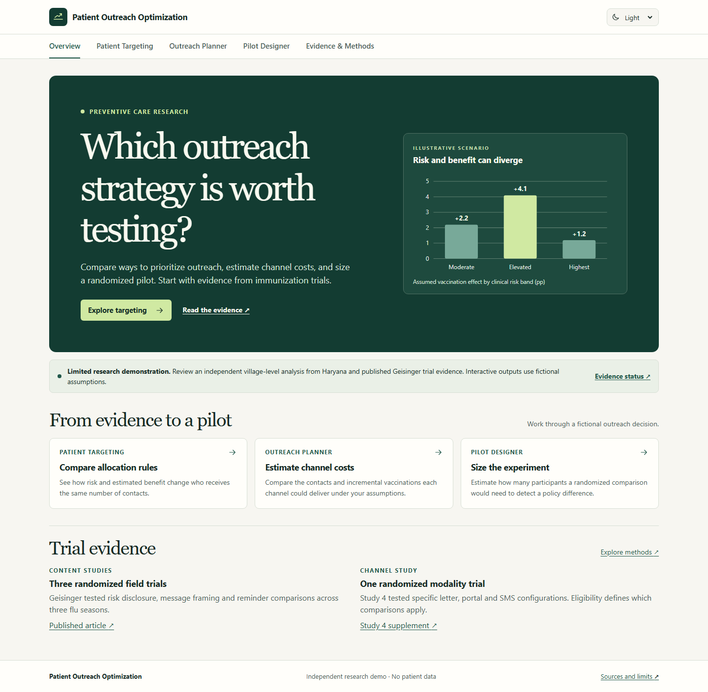
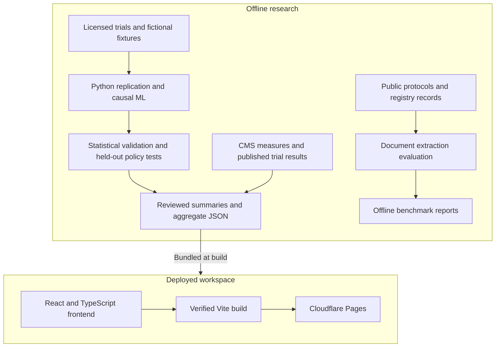

# Patient Outreach Optimization

## Project Overview

Preventive-care teams have limited time and budget to contact patients about flu vaccinations and screenings. This workspace helps them decide which outreach strategy is worth testing, how many people they can reach, and how large a pilot they would need. Planning tools use fictional inputs alongside separately presented research findings.

## Live Demo

**[Open the live workspace](https://patient-outreach-optimization.pages.dev/)** · [v0.5.0-demo](https://github.com/AbhinavVarma02/Patient-Outreach-Optimization/tree/v0.5.0-demo)



## Key Features

- **Patient Targeting** compares rules based on clinical risk or expected benefit with uniform outreach at the same contact capacity.
- **Outreach Planner** compares channel costs and reach. A Medicare Advantage scenario shows how many additional screenings or vaccinations would close a hypothetical gap against a CMS benchmark.
- **Pilot Designer** estimates sample size, statistical power and the smallest effect a randomized comparison could detect at the selected power.
- **Evidence & Methods** presents published trials, study replications and the limits of the results.

## System Architecture



Scenario calculations run in the browser. Training, policy evaluation and document extraction run offline.

## Technology Stack

| Layer | Tools |
| --- | --- |
| Research and causal modeling | Python, NumPy, pandas, SciPy, statsmodels |
| Offline document evaluation | ClinicalTrials.gov, pypdf, Ollama |
| Browser workspace | React, TypeScript, Vite |
| Verification and hosting | Playwright, axe, GitHub Actions, Cloudflare Pages |

## Research & Key Findings

| Evidence | Verified result |
| --- | --- |
| [Medicare Advantage benchmarks](docs/US_PAYER_EVIDENCE.md) | Four CMS 2027 quality and experience measures summarized across 675 coordinated care contracts. These are descriptive benchmarks. |
| [US randomized outreach](docs/US_PAYER_EVIDENCE.md#randomized-us-outreach) | UCLA text and portal reminders had results consistent with no effect. The SCORE mailed testing bundle increased six-month colorectal screening by 20.29 percentage points in the studied North Carolina health centers. |
| [Haryana immunization](docs/HARYANA_RESEARCH.md) | Replicated 1.89 additional recorded measles vaccinations per village-month. The 95% interval clustered by primary health center included zero. |
| [Sierra Leone mobile vaccination](docs/SIERRA_LEONE_RESEARCH.md) | Mobile clinics plus community mobilization increased adult vaccination by 26.07 percentage points versus control (95% CI 22.50 to 29.64). At 50% expected village capacity, the learned rules showed no reliable gain over uniform allocation in 20 held-out village triplets. |
| [Offline trial document benchmark](docs/AI_EVALUATION.md) | On 12 held-out protocols, the best rules matched 7 of 13 scorable fields, the local model matched 8, and the model with verification matched 2. The benchmark missed the release criteria. |

## Getting Started

From the repository root, start the web app with Node.js 24 or later. Open the local URL printed by Vite.

```sh
cd web
npm ci --ignore-scripts
npm run dev
```

From the repository root, reproduce the fictional research checks with Python 3.12 or later. The fictional replay uses the standard library and needs no study downloads.

```sh
python scripts/reproduce.py fictional
```

See the [reproducibility guide](docs/REPRODUCIBILITY.md#final-offline-replay) for pinned inputs and the full offline replay.

## Documentation

| Area | Guides |
| --- | --- |
| Engineering | [Technical master guide](docs/MASTER_TECHNICAL_GUIDE.md) · [Architecture](docs/ARCHITECTURE.md) · [Deployment](docs/DEPLOYMENT.md) |
| Research | [Research report](docs/RESEARCH_REPORT.md) · [Experiment report](docs/EXPERIMENT_REPORT.md) · [Model validation](docs/MODEL_VALIDATION.md) |
| Walkthrough | [Interview guide](docs/INTERVIEW_GUIDE.md) |

## Limitations & Future Research

- Geisinger participant-level analysis awaits documented reuse permission.
- Patient-level targeting requires validation in a comparable randomized study. Structure-level targeting in Sierra Leone requires the original lottery and observation records.
- The demo uses reviewed trial summaries. Automated extraction remains experimental pending evaluation on a new, independently reviewed holdout.

## License & Data Attribution

Original code is [MIT licensed](LICENSE). Research datasets and publications carry separate terms.

- **Haryana** uses the [Banerjee et al. replication archive](https://zenodo.org/records/11392582) under CC BY 4.0.
- **Sierra Leone** uses the [Meriggi et al. replication data](https://doi.org/10.7910/DVN/PRXF5Z) under CC0 1.0.
- **US evidence** draws on CMS Star Ratings, UCLA registry results and the published SCORE trial. [Source attribution and reuse notes](docs/US_PAYER_EVIDENCE.md) · [Data permissions](docs/LICENSING.md)
