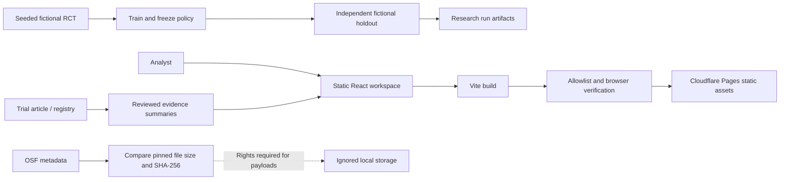

# Architecture

Python implements known-propensity estimators, prospective sample size, deterministic metadata extraction, a local model smoke runner and acquisition. Browser TypeScript computes planner, targeting and pilot results without a network service. Public study evidence is reviewed source material. Experiment artifacts remain outside the web build. Production requires the artifact allowlist, claim review and live tests.
