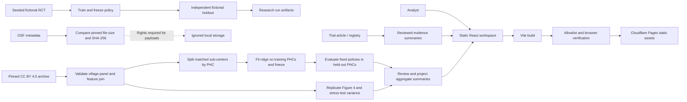
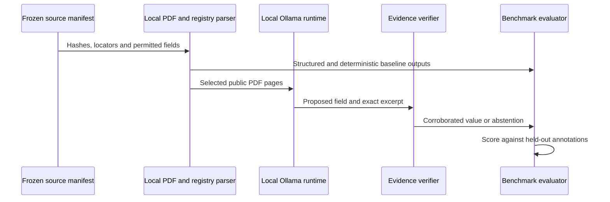

# Architecture

Python implements known-propensity estimators, prospective sample size, deterministic metadata extraction, a frozen local model benchmark and acquisition. Browser TypeScript computes planner, targeting and pilot results without a network service. The checked Haryana JSON projection is the only empirical pipeline input to the web build. Complete experiment artifacts and fitted parameters remain outside that build. Production requires the artifact allowlist, claim review and live tests.

