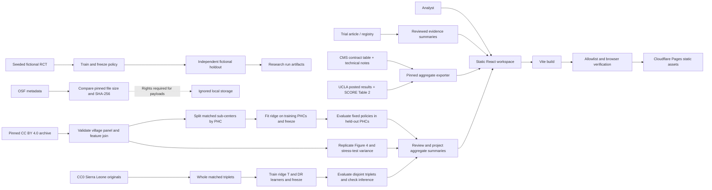
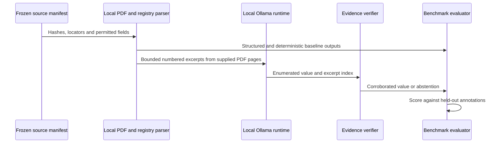
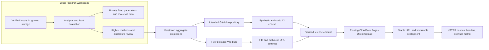

# Architecture

Python implements known-propensity estimators, prospective sample size, deterministic metadata extraction, a frozen local model benchmark and acquisition. Browser TypeScript computes targeting, campaign cost, CMS benchmark gap and pilot results without a network service. The build reads the checked Haryana, Sierra Leone and US JSON projections and reviewed trial summaries. The CMS benchmark is an arithmetic reference. Randomized trial values are a separate evidence path. [US data lineage](US_PAYER_EVIDENCE.md) · [Model artifacts](MODEL_CARD.md)

## Static release boundary

